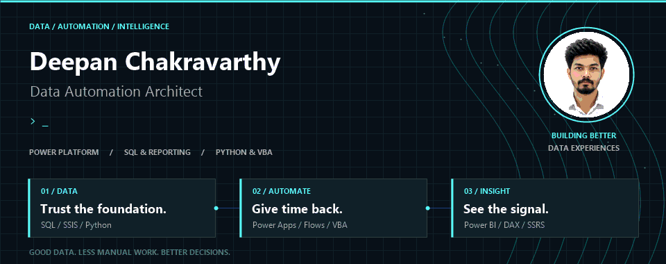
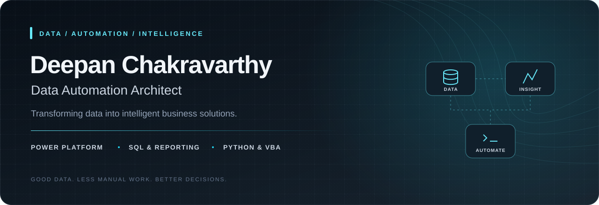
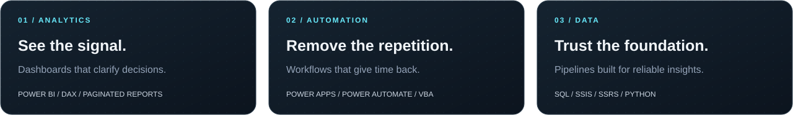

### Less repetition. More intelligence. Real impact.

**Deepan Chakravarthy** · Data Automation Architect · He/Him

I build business intelligence, automation, and reporting solutions that make information easier to trust, work with, and act on. My focus is scalable dashboards, automated reporting pipelines, and intelligent workflows that reduce manual effort and improve operational visibility.

**[LET'S CONNECT ↗](https://www.linkedin.com/in/deepan-chakravarthy-7129771a0/)** · [Explore my GitHub](https://github.com/DeepanDC)

Prefer a still banner? Open the animation-free version.

---

## From raw data to real impact

| Focus | From complexity to clarity |
| :--- | :--- |
| **Business intelligence** | Interactive Power BI dashboards, optimized data models, DAX, KPI visibility, and paginated reports. |
| **Workflow automation** | Power Apps, Power Automate, SharePoint, and Adaptive Cards that streamline business operations. |
| **Reporting pipelines** | SQL, SSIS, SSRS, and Python solutions that replace repetitive reporting processes. |
| **Desktop & web tooling** | VBA macros, user forms, and HTML, CSS, and JavaScript interfaces for practical automation. |
| **Data quality** | Data validation, trend analysis, and performance optimization for reliable insights. |

## The stack behind the solutions

**Analytics & reporting**  
Power BI · DAX · Paginated Power BI · SSRS

**Apps & automation**  
Power Apps · Power Automate · SharePoint · Adaptive Cards · VBA · Macros · User Forms

**Data & integration**  
SQL · SSMS · SSIS · Python

**Web & collaboration**  
HTML · CSS · JavaScript · GitHub

## Results that matter

*Reported outcomes across my projects, as described in my professional background.*

| Reporting turnaround | Data quality | Stakeholder visibility |
| :---: | :---: | :---: |
| **30–50% faster** | **40%+ less inconsistency & rework** | **Clearer KPIs & operational metrics** |

## How I work

I combine a problem-solving mindset, attention to detail, and clear communication with both technical and non-technical stakeholders. I continuously expand my automation and reporting skills to deliver scalable, future-ready analytics solutions.

---

**Good data. Less manual work. Better decisions.**

[Let's connect on LinkedIn](https://www.linkedin.com/in/deepan-chakravarthy-7129771a0/)
